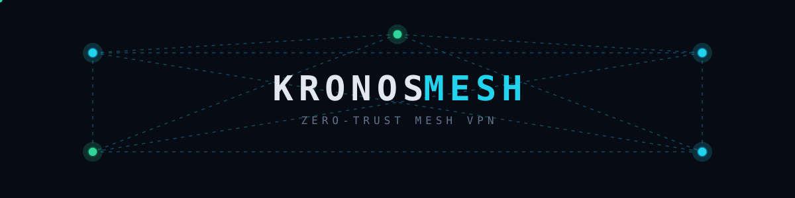
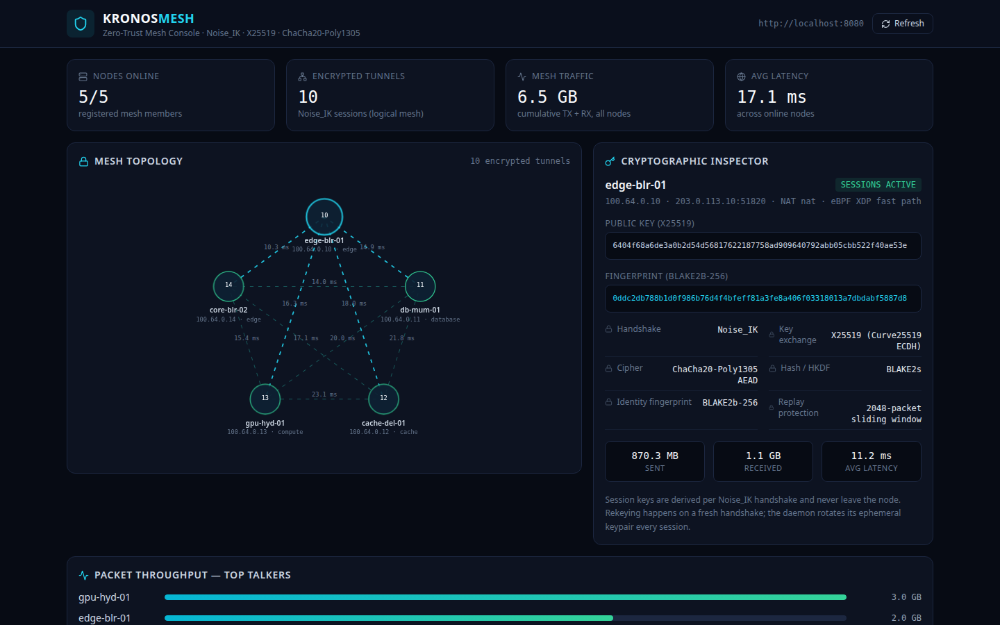
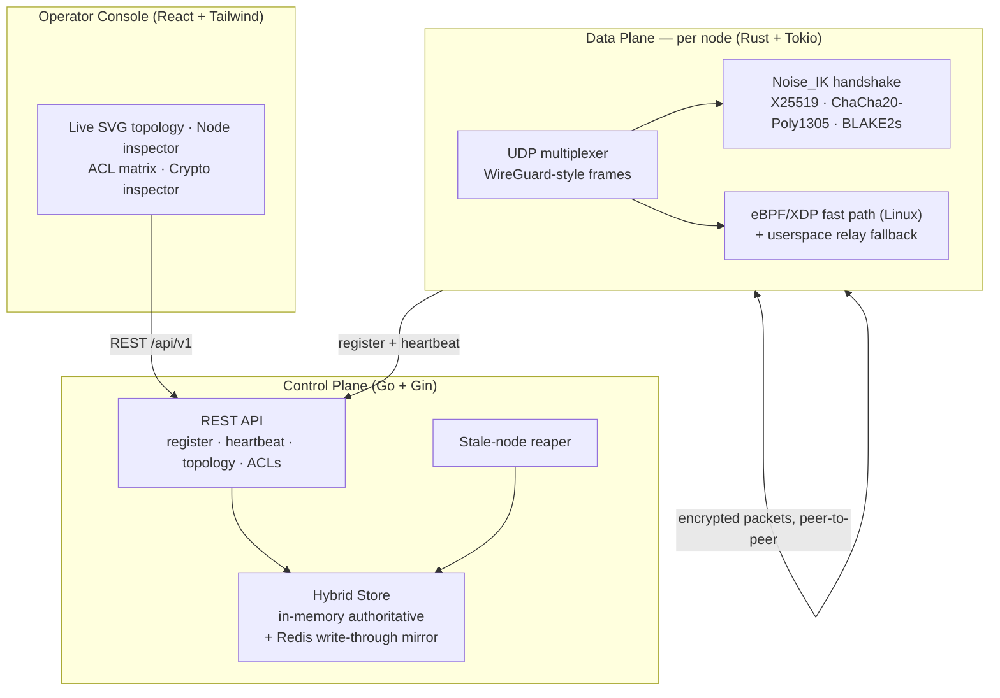

# KronosMesh



**Enterprise Zero-Trust Mesh VPN, eBPF Packet Router, and Cryptographic Overlay Network.**
An open-source alternative to Tailscale and Cloudflare Tunnels — connect servers and computers anywhere in the world into one secure, encrypted, private network, with **no paid third-party cloud dependency**. You run the control plane; your traffic never touches anyone else's infrastructure.

[](https://github.com/Thegreatprabh/KronosMesh/actions/workflows/ci.yml)




---

## Why KronosMesh?

Legacy VPNs fail in predictable ways:

- **Hub-and-spoke latency** — traffic hairpins through a central gateway even when two peers sit in the same city.
- **Perimeter trust** — once you are "inside" the VPN, you can reach everything. One compromised laptop becomes a skeleton key.
- **Vendor lock-in** — hosted coordination servers mean your network's control plane belongs to someone else, and stops working when their cloud does.

KronosMesh is built the other way:

- **Peer-to-peer data plane** — nodes talk directly (with mesh relaying when direct paths fail); the control plane only coordinates identity and policy, never carries your packets.
- **Zero trust by construction** — every node has an X25519 identity verified by BLAKE2b fingerprint at registration; every packet is sealed with ChaCha20-Poly1305 after a Noise_IK handshake; ACL policy is role-based (`source role → destination service : port`), default deny.
- **Self-hosted everything** — the control plane is a single Go binary with an in-memory store (optional Redis mirror). No accounts, no SaaS, no phone-home.
- **Fast where it counts** — a Rust data plane with an eBPF/XDP fast path on Linux, and a fully working userspace relay everywhere else.

## Architecture



## Performance

Measured with the built-in benchmark (`kronos-daemon bench`) on a 2-vCPU cloud VM, release build. The bench runs two real daemon cores in-process (Noise_IK handshake + full seal/open path on every packet, 1200-byte payloads) — it measures KronosMesh's cryptographic protocol path on commodity hardware, not a synthetic micro-benchmark.

| Metric | KronosMesh (measured) | OpenVPN (typical, userspace TLS) | WireGuard® (typical, kernel) |
|---|---|---|---|
| Handshake | **26.6 ms** (cold, full Noise_IK) | ~100–300 ms (TLS) | ~1 RTT after first packet |
| Crypto-path throughput | **641 Mbps** | ~200–500 Mbps | multi-Gbps |
| Packet rate | **77,969 pps** | — | — |
| CPU model | 1 core saturated, AEAD in userspace | userspace | kernel |

> Competitor figures are widely published typical ranges for orientation, not measurements from this project. Reproduce ours: `cargo run --release -p kronos-daemon -- bench --seconds 10`.

## Quickstart (60 seconds)

```bash
git clone https://github.com/Thegreatprabh/KronosMesh.git
cd KronosMesh
docker compose up --build
```

That starts Redis, the control plane (`:8080`), the dashboard (`:5173`), and two mesh nodes. Open **http://localhost:5173** — you should see both nodes online, linked by an encrypted tunnel.

### Manual setup

```bash
# 1. Control plane
cd control-plane && go run .            # listens on :8080, no Redis required

# 2. A node (each machine)
cd core/daemon
cargo run --release -- up               # generates its identity on first run
cargo run --release -- status           # identity, fingerprint, mesh summary
cargo run --release -- peers            # peer table from the control plane

# 3. Dashboard
cd apps/dashboard && npm install && npm run dev   # http://localhost:5173
```

Node configuration is TOML + environment (environment wins):

```toml
# kronos.toml
node_name = "edge-blr-01"
role = "edge"
control_url = "http://127.0.0.1:8080"
listen_port = 51820
```

| Env var | Meaning |
|---|---|
| `KRONOS_NODE_NAME` / `KRONOS_ROLE` | Node identity metadata |
| `KRONOS_CONTROL_URL` | Control plane base URL |
| `KRONOS_LISTEN_PORT` | UDP listen port (default 51820) |
| `KRONOS_STATE_DIR` | Identity/state directory (default `.kronos`) |
| `KRONOS_STUN_SERVER` | Optional STUN server for public-endpoint discovery |
| `KRONOS_ADVERTISE_ENDPOINT` | Explicit `host:port` to register with the control plane (overrides discovery; the right knob behind NAT/port mapping) |
| `KRONOS_EBPF_OBJECT` | Optional compiled eBPF object to validate at startup |

## How it works

**Identity.** On first run each daemon generates an X25519 static keypair, stored in its state directory (`0600`). The node's fingerprint — BLAKE2b-256 of the public key — is its identity. At registration the control plane *recomputes* the fingerprint from the presented public key and rejects mismatches: a node cannot claim another node's identity.

**Handshake.** Peers run a Noise_IK handshake (the initiator already knows the responder's static key from the control plane's peer list): `→ e, es, s, ss` / `← e, ee, se`, with HKDF-BLAKE2s key schedule and ChaCha20-Poly1305 throughout — the same primitive family as WireGuard®, implemented here from the Noise Protocol Framework spec. Unknown keys are dropped silently, exactly like WireGuard®.

**Transport.** WireGuard-style frames (`type ‖ indices ‖ counter ‖ AEAD ciphertext`) over UDP, a 2048-packet sliding replay window, keepalives, and roaming (endpoints are re-learned from authenticated traffic). If a destination is not a direct peer, intermediate nodes relay the sealed packet — the relay never sees plaintext.

**Data plane modes.** On Linux the daemon probes for XDP capability (kernel, privileges, optional object validation) and engages the eBPF fast path when available. Every other environment — containers without `CAP_BPF`, macOS, Windows — runs the userspace relay with identical semantics. `kronos-daemon up` prints exactly which mode engaged and why.

**Zero-trust enforcement.** ACL policy is not just stored centrally — daemons sync it continuously and the Rust data plane enforces it in the tunnel itself: rules with destination `*` or `mesh-data` and port `0` (wildcard) govern mesh traffic, are evaluated in priority order (first match decides), and a matching DENY drops the packet on both send and receive paths, counted in telemetry and logged. Port `0` means "any port" throughout the system.

**Control plane.** Gin REST API: node registration with CGNAT-range (`100.64.0.0/10`) virtual-IP assignment, heartbeat telemetry, mesh topology, and versioned ACL policy that daemons sync continuously. Nodes that stop heartbeating are reaped to `offline` after 45 s. The store is in-memory and authoritative; with `REDIS_ADDR` set, writes are mirrored to Redis for external tooling.

**Shared contracts.** One JSON contract (`contracts/` at the repo root) pins the payloads shared by the daemon, the control plane, and the dashboard. Both the Rust and Go test suites assert their types against those fixtures, so the three codebases cannot silently drift.

## Repository layout

```
kronos-mesh/
├── core/daemon/        Rust data plane: Noise_IK crypto, UDP tunnel + relay,
│                       eBPF loader with userspace fallback, control client, CLI
├── control-plane/      Go control plane: registry, topology, ACL policy (Gin)
├── apps/dashboard/     React console: topology map, ACL matrix, crypto inspector
├── contracts/          Cross-language JSON contract fixtures
├── docker-compose.yml  redis + control plane + dashboard + 2 mesh nodes
└── Makefile            build-all · dev · test · docker-up · clean
```

## Verification

Every layer is tested, and the suites run in CI:

- **Rust** — Noise_IK handshake round-trips, HMAC/HKDF-BLAKE2s vectors cross-checked against reference implementations, fingerprint vectors shared with Go, replay/tamper rejection, 2-node exchange and 3-node relay over an in-memory transport, STUN parsing, eBPF object validation.
- **Go** — registration/IP allocation, heartbeat + reaper, ACL versioning, full HTTP flows, and contract-fixture shape equality with the Rust types.
- **Dashboard** — strict TypeScript (`tsc --noEmit`) + production Vite build.

## Honest status

- The framing and handshake are KronosMesh's own implementation of the Noise_IK pattern with WireGuard-style packet layout; it is **not** wire-compatible with the WireGuard® protocol itself.
- The eBPF fast path engages only where the kernel and privileges allow; the loader reports its decision and reason at startup, and the userspace plane is a first-class citizen, not a stub.
- Redis is a write-through mirror, not the source of truth — restart recovery of control-plane state is roadmap work, as are Ed25519-signed policy bundles and a TUN device consumer for host-level routing.

## License

MIT — see [LICENSE](LICENSE). WireGuard® is a registered trademark of Jason A. Donenfeld; KronosMesh is not affiliated with or endorsed by WireGuard® or Tailscale Inc.
